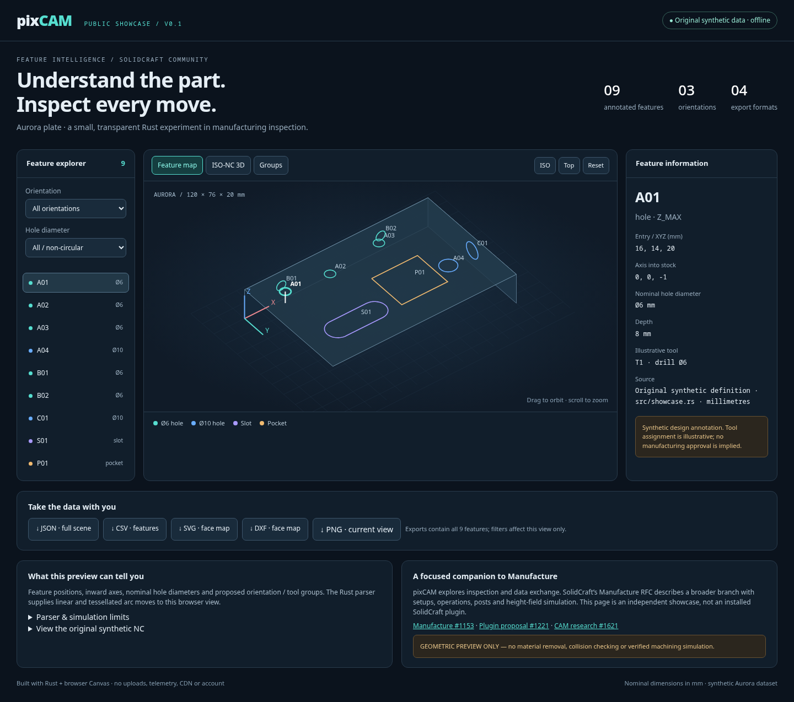

# pixCAM · public showcase v0.1

**Understand the part. Inspect every move.** A standalone, offline browser demonstration built from a small Rust core, prepared for the SolidCraft community.



## Run it

Open **[dist/index.html](dist/index.html)** in a browser. It is self-contained: no server, account, upload, CDN, JavaScript package installation or Rust runtime is needed. All four export downloads are embedded in the HTML.

To rebuild from source (Rust 1.95+):

```sh
cargo run --locked --release -- build dist
```

Then open `dist/index.html`. On Linux: `xdg-open dist/index.html`.
Use `--offline` after the Cargo dependencies have been cached. The generator replaces its six named output files in the selected directory; use a new directory to preserve earlier results.

## What actually works

- A rotatable, zoomable 3D feature map with seven nominal holes (Ø6 and Ø10 mm), a slot and a pocket; three orientations and nine selectable annotations.
- Orientation and diameter filters, five proposed orientation/tool groups, coordinates, inward axes, feature types, depth and explicit source information.
- A bounded Rust ISO-NC parser and 27 illustrative moves, with separate colors for rapid, linear feed and arc moves. Scrubbing and playback follow path distance.
- Deterministic JSON/CSV/SVG/DXF exports, including non-circular outlines. Browser filters affect the view; downloads always include all nine features. PNG captures the current viewport.
- Three local, read-only MCP tools with typed input/output schemas: `inspect_features`, `explain_nc_cycle`, `validate_coordinate_transform`.
- Responsive browser UI, keyboard orbit controls, no network requests during the demo.

The viewer uses translucent projected outlines, not a B-rep or a depth-tested solid renderer. Features on opposite faces can remain visible. Select an orientation to isolate a face.

## Original synthetic part

Aurora is a new 120 × 76 × 20 mm inspection plate. Its geometry is defined in `src/showcase.rs`; `fixtures/aurora.nc` was written specifically for this demonstration. There are no imported customer models, industrial NC programs, machine definitions, manufacturer documents or copied reference images.

| Feature | Entry XYZ, mm | Inward axis | Nominal geometry |
|---|---|---|---|
| A01 / A02 / A03 | (16,14,20) / (43,17,20) / (78,13,20) | (0,0,-1) | Ø6, depth 8 mm |
| A04 | (96,49,20) | (0,0,-1) | Ø10, depth 10 mm |
| B01 / B02 | (24,0,10) / (89,0,10) | (0,1,0) | Ø6, depth 12 mm |
| C01 | (120,38,10) | (-1,0,0) | Ø10, depth 14 mm |
| S01 | (32,54,20) | (0,0,-1) | capsule slot, 38 × 14 × 6 mm |
| P01 | (73,46,20) | (0,0,-1) | schematic pocket, 30 × 26 × 7 mm |

Non-circular `entry_mm` values are annotation centers, not programmed cutter entry points. The pocket has schematic square corners; an illustrative round end mill does not establish their manufacturability. Tool assignments are not cutting recommendations.

SVG and DXF contain three **unmirrored face projections**: Z_MAX → XY, Y_MIN → XZ, X_MAX → YZ. DXF is a 2D drawing in millimetres (`$INSUNITS=4`): panels are offset by 0, 146 and 292 mm along drawing X; layers identify face and feature. Holes are exact CIRCLE entities, slot/pocket outlines are LINE entities. JSON retains world coordinates and axes. SVG slot outlines and DXF slot lines are sampled nominal contours, not exact analytic machining geometry. Import into SolidCraft has not been validated.

## Limits: geometric preview, not verified machining simulation

The example NC illustrates **top-face moves only**, with hand-authored hole approaches, a slot loop and one pocket loop. It is not generated from the annotations. Side holes, complete pocket clearing, corner finishing and a production sequence are absent. Do not send it to a machine.

Supported parser subset: G0/G1/G2/G3; G17/G18/G19; G20/G21; G90/G91; G94; F/S/T; M6, M2/M30; M3/M4/M5/M8/M9 as metadata. Arcs require incremental IJK centers, including full circles and helices. G54–G59 require explicit transforms through the Rust API. Defaults are mm, absolute positioning, XY plane and initial position [0,0,0]. Arc tessellation uses a 0.02 mm chord tolerance.

Unknown/ambiguous instructions reject the entire program. There is no canned-cycle expansion, CYCLE800 implementation, rotary output, compensation, R arcs, macros or subprogram execution. The UI displays the built-in parsed NC; arbitrary NC import is not a browser feature. `explain_nc_cycle` reports support/rejection for short supplied snippets and does **not** explain proprietary cycle semantics.

There is no stock removal, collision/gouge verification, holder/fixture/machine model, force model, postprocessor or cycle-time estimate. Playback is distance based, not feed based. This is neither a full CAM system nor a validated machining simulator.

## Review materials

- [Feature map screenshot](media/01-feature-map.png)
- [Orientation/tool groups screenshot](media/02-orientation-groups.png)
- [ISO-NC preview screenshot](media/03-nc-preview.png)
- [72-second demonstration video](media/pixcam-aurora-72s.mp4) — original browser recording, English on-screen captions, no audio
- [SolidCraft comparison and proposed integration](docs/SOLIDCRAFT.md)
- [Read-only MCP tools](docs/MCP.md)
- [Privacy provenance and release boundary](docs/PRIVACY.md)
- [Verification and reproduction](docs/VERIFICATION.md)

## Source layout

`src/core.rs` retains generic vector, face and rigid-transform primitives from the existing pixCAM Rust implementation. `src/nc.rs` reuses its bounded parser. `src/showcase.rs` defines the new synthetic annotations, groups and exports. `src/mcp.rs` provides the local read-only tools. `assets/index.html` is the original showcase UI template; `dist/` contains generated, reviewable browser artifacts.

No ancestor Git history or old fixtures were imported into this public repository. See the privacy report for the exact release boundary. License: MIT, consistent with the existing pixCAM crate declaration.
