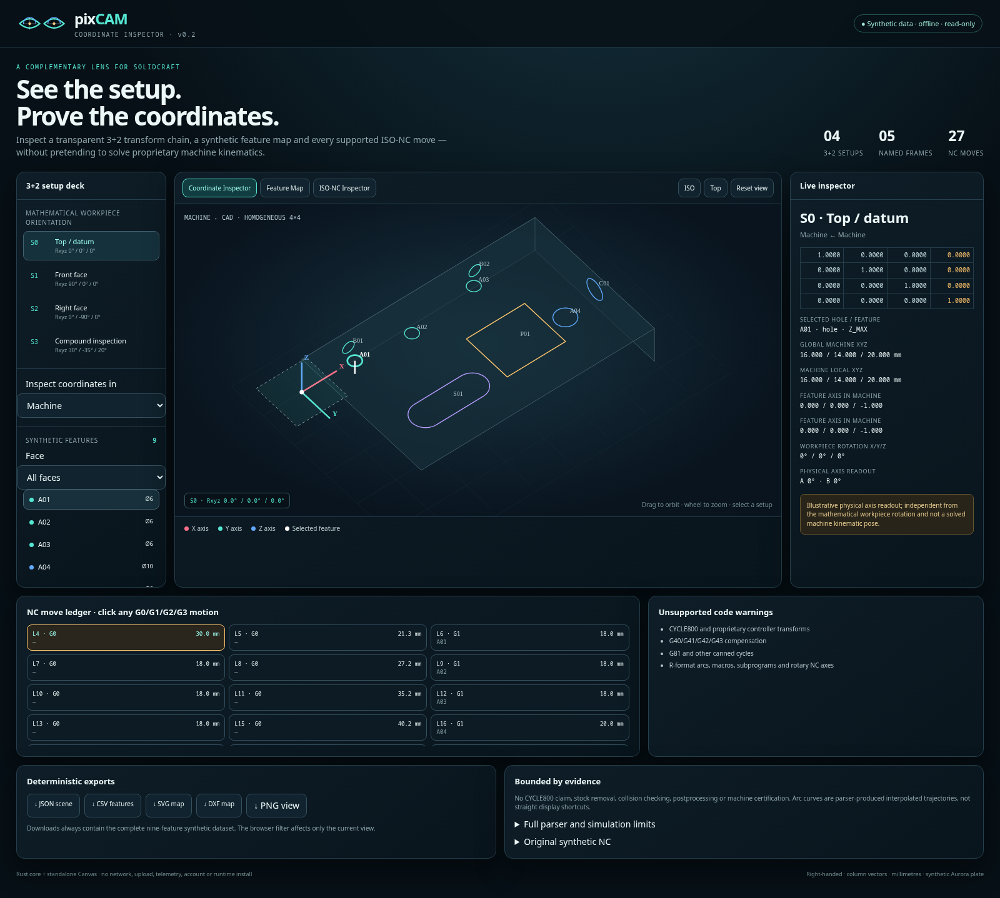
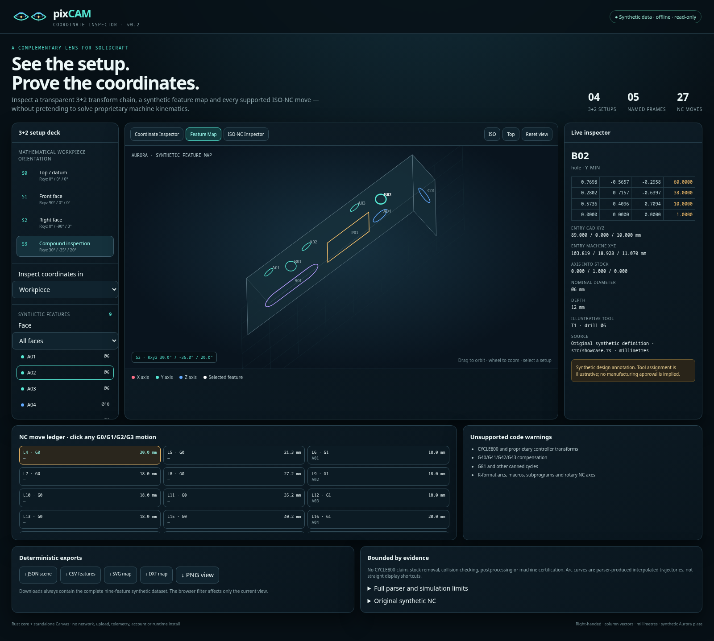
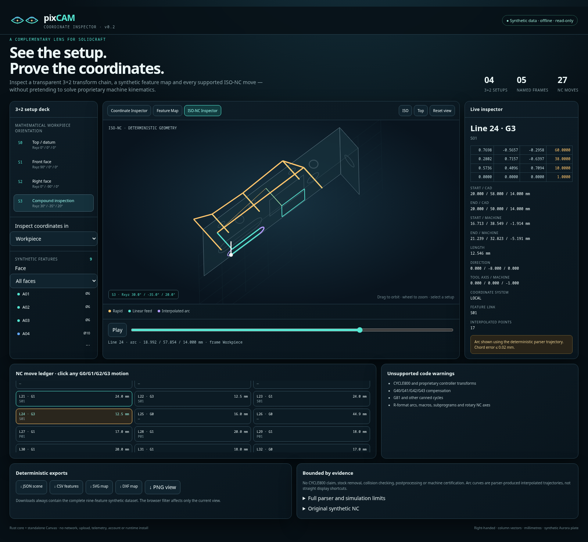

# pixCAM · Coordinate Inspector showcase v0.2

**See the setup. Prove the coordinates.** A standalone, offline demonstration of 3+2 coordinate inspection, synthetic feature mapping and bounded ISO-NC explanation, prepared as a complementary experiment for the SolidCraft community.



## Run the showcase

Open **[dist/index.html](dist/index.html)** directly in a browser. It is self-contained: no server, account, upload, CDN, JavaScript package installation or Rust runtime is needed. The exports are embedded in the HTML.

To rebuild with Rust 1.95+:

```sh
cargo run --locked --release -- build dist
```

On the target workstation (7510), `cargo run --locked --release --offline -- build dist` works after dependencies have been cached.

## Coordinate Inspector

- A right-handed homogeneous 4×4 library with row-major storage, column vectors and active rotations. `A.compose(B)` applies `B` first; `machine_from_cad` maps CAD points into Machine coordinates.
- Point, vector and tool-axis transforms; X/Y/Z rotations; translation; composition; validation and rigid inverse.
- Five explicit frames: Machine, Workpiece, Setup, Tool and CAD.
- Four animated synthetic 3+2 setups: datum, front, right and compound inspection.
- Live matrix plus local/global coordinates, visible XYZ axes, origins and work plane.
- Any feature can be inspected in any frame. The selected hole's axis and position update with the setup.
- Mathematical workpiece orientation and illustrative physical A/B readouts are separate fields. The demo does **not** solve machine kinematics or claim CYCLE800 support.



## ISO-NC Inspector

The bounded Rust parser supplies 27 deterministic motions. Every G0/G1/G2/G3 ledger row is clickable and reports start, end, polyline length, direction, tool axis, coordinate system and a feature link when known. G2/G3 are displayed from the parser's interpolated trajectory with a maximum 0.02 mm chord error.

Unsupported or ambiguous input fails closed. The viewer lists unsupported controller transforms, compensation, canned cycles, R arcs, macros, subprograms and rotary NC axes. It performs no Boolean stock removal, collision checking, postprocessing or cycle-time simulation.



Supported subset: G0/G1/G2/G3; G17/G18/G19; G20/G21; G90/G91; G94; F/S/T; M6, M2/M30; M3/M4/M5/M8/M9 as metadata. Arc centres are incremental IJK. G54–G59 require explicit transforms through the Rust API.

## Original synthetic public data

Aurora is a new 120 × 76 × 20 mm inspection plate defined in `src/showcase.rs`; `fixtures/aurora.nc` was written for this demo. It has seven holes, one capsule slot and one schematic pocket. No customer models, production programs, machine definitions, manufacturer documents or reference photographs are included.

Deterministic JSON, CSV, SVG and DXF exports retain all nine annotations. PNG captures the current browser viewport. The exported face map uses unmirrored Z_MAX→XY, Y_MIN→XZ and X_MAX→YZ projections.

## SolidCraft v0.17 integration boundary

SolidCraft v0.17.0 documents read-only `inspect_design`, `measure` and `body_topology` MCP tools, including a bridge to a running app with `solidcraft-cli mcp --connect`. `src/solidcraft.rs` imports a captured, version-pinned read-only snapshot into a neutral pixCAM map of timeline definitions and cylindrical body faces:

```sh
pixcam-showcase import-solidcraft-snapshot snapshot.json
```

The adapter deliberately leaves `timeline_feature_id` empty: v0.17 exposes timeline definitions and evaluated body topology separately, but does not document a one-call feature-to-evaluated-face association. A live bridge was not run here because `solidcraft-cli` is not installed on this workstation. The proposed WIT plugin ABI in issue #1221 is future-only; the showcase does not claim it exists. See [the evidence and blocker report](docs/SOLIDCRAFT.md).

## Branding

Three original vector directions are included under `assets/brand`: Technical / Precision, Optical / Surreal and Minimal / Industrial. Concept A is selected for the engineering UI, with light and dark marks, a horizontal wordmark and SVG favicon. The artwork interprets two painted closed eyes through toolpath arcs, centre targets and coordinate symmetry; it does not reproduce a photograph. See [BRAND.md](docs/BRAND.md).

## Verification and review

- `cargo test --locked --offline`: 20 public tests.
- `cargo clippy --locked --offline --all-targets -- -D warnings` and `cargo fmt --check`.
- Browser automation: setups, frames, matrices, feature coordinates, all 27 motions, arcs, exports, responsive layout, no network requests or JavaScript errors.
- MCP schemas and six real stdio results.
- Privacy allowlist, synthetic contract and complete local Git-object scan before release commit.
- 100-run build benchmark: median 6.427 ms, p95 8.327 ms; six files, 439,956 bytes on this workstation.

See [verification](docs/VERIFICATION.md), [benchmark](docs/BENCHMARK.md), [privacy boundary](docs/PRIVACY.md), [MCP tools](docs/MCP.md) and the [72-second walkthrough](docs/WALKTHROUGH.md).

License: MIT. No push or publication is performed by this repository workflow.
