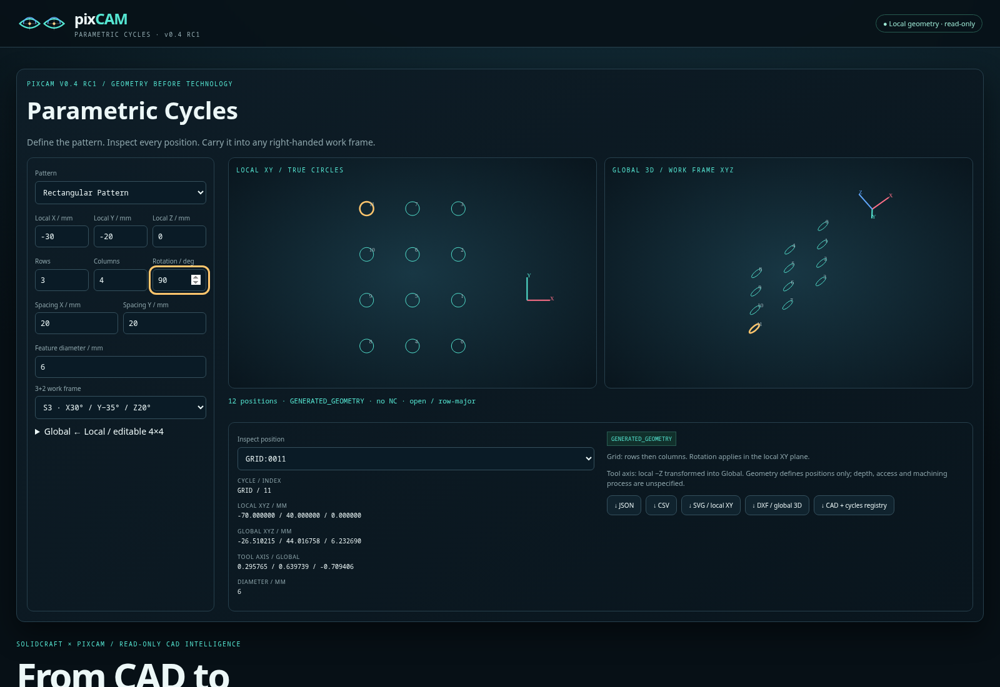
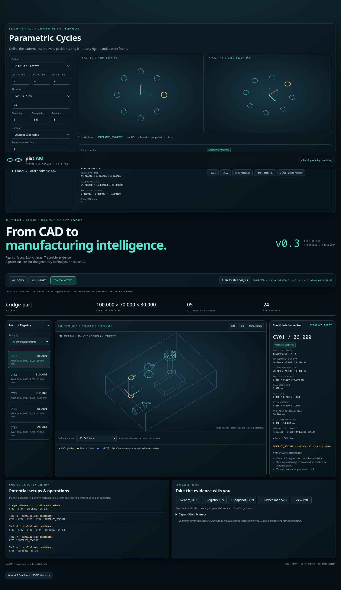
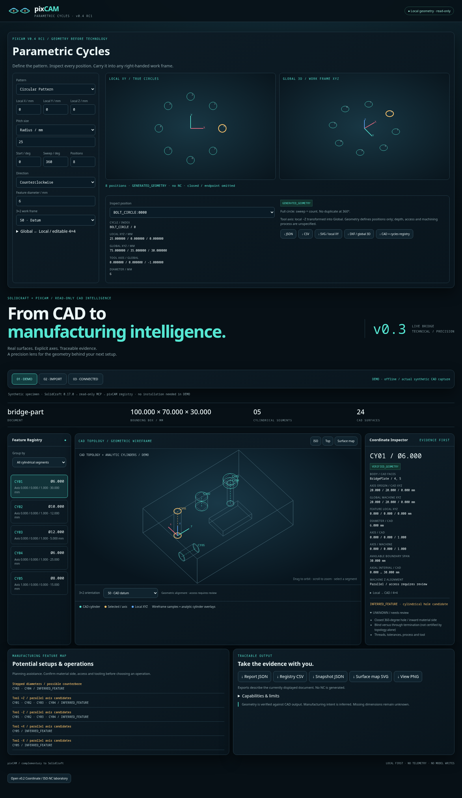
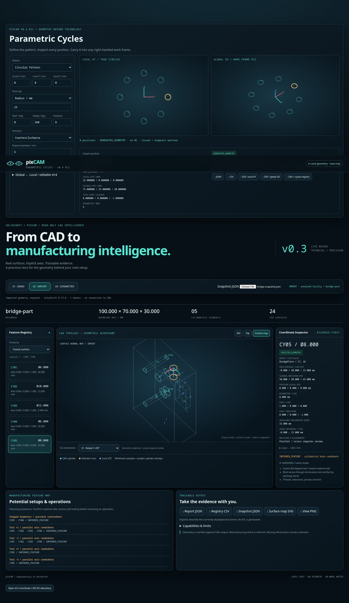

# pixCAM v0.4 RC1 · Parametric Cycles & SolidCraft Live Bridge

From SolidCraft CAD to Manufacturing Intelligence: a working read-only CAD bridge, geometry registry and Coordinate Inspector.

## New in v0.4 RC1

Open **[dist/index.html](dist/index.html)** and use **Parametric Cycles** at the top. Circular Pattern generates a bolt circle or open arc; Rectangular Pattern generates a rotated row/column grid. Edit parameters to update local 2D and global 3D views immediately, choose one of four 3+2 work frames or enter any valid rigid 4×4, then inspect an individual position.

Export the current pattern as JSON, CSV, local-XY SVG or global-3D DXF. The combined registry export preserves imported SolidCraft geometry alongside generated cycle features and their parameter provenance. Generated positions are marked GENERATED_GEOMETRY; they are not measured CAD holes. Invalid parameters disable exports while clearly marking the retained prior view.




Run the same geometry in Rust:

```sh
cargo build --release --locked --offline
./target/release/pixcam-showcase cycle fixtures/cycle-circular.json cycle-output
./target/release/pixcam-showcase cycle fixtures/cycle-rectangular.json grid-output
./target/release/pixcam-showcase registry fixtures/bridge-snapshot.json fixtures/cycle-circular.json
```

Counts are bounded to 1024. Full circles omit the duplicate closing position; open arcs include endpoints. Spacing/sizes must be positive, coordinates and angles may be zero. Numerical duplicate/precision checks are distinct from machining tolerances. See [cycle conventions and limitations](docs/CYCLES.md).

The local release package is **pixcam-public-v0.4-rc1.zip**. Unzip it and open `pixcam-public-v0.4-rc1/dist/index.html`; no server, Rust or CAD installation is needed for the offline demo. Source, startup instructions, screenshots, the new [24-second cycles film](media/pixcam-parametric-cycles-24s.mp4) and prior bridge evidence are included. Build the reviewed archive from a clean release commit using `python3 scripts/package-rc.py`; it excludes Git history and build/test caches and produces a SHA-256 sidecar.

The [short English CAM discussion draft](docs/SOLIDCRAFT_CAM_DRAFT.md) is prepared for review. Neither it nor the package has been published. The existing read-only bridge, Coordinate Inspector, ISO-NC laboratory and their exports remain available below the new panel.



## Try it

Open [dist/index.html](dist/index.html) directly. DEMO runs entirely offline, showing actual geometry captured from our original synthetic SolidCraft specimen. Rust and SolidCraft are not needed to view it.

- DEMO: embedded synthetic CAD capture; five cylindrical segments and 24 surfaces.
- IMPORT: choose a SolidCraft snapshot JSON or a pixCAM report containing its source snapshot. Offline recognition stays in the browser. Nothing is uploaded.
- CONNECTED: open the URL printed by the local Rust adapter, then choose CONNECTED and Refresh analysis. It reads either an isolated headless document or an explicitly configured active app.

## Linux / Precision 7510

Use Rust 1.95+ and matching SolidCraft 0.17.0. All CAD invocations use the pinned absolute CLI path in `src/bridge.rs`; the older CLI installation is untouched.

```sh
cargo build --release --locked --offline
./target/release/pixcam-showcase bridge --in fixtures/bridge-part.solidcraft
```

Open the printed localhost URL. The adapter chooses an available HTTP port. For the active app, supply its actual control port:

```sh
./target/release/pixcam-showcase bridge --connect 127.0.0.1:PORT
```

Replace PORT with the app's configured port; there is no hardcoded control port. See [integration and startup](docs/SOLIDCRAFT.md) for app launch, capture and verification commands.

## What works

The Rust client implements MCP JSON-RPC 2.0 initialization, initialized notification, bounded stdio messages, deadlines, clean process shutdown and one fresh-session retry. Its allowlist contains exactly `list_commands`, `inspect_design`, `measure` and `body_topology`.

Recognition records CAD cylinder radii/diameters, axis lines, adjacent boundary spans and local right-handed 4×4 frames. It merges compatible patches and groups diameters, parallel axes and coaxial surfaces. Adjacent coaxial diameters become a possible counterbore hypothesis. Planar normals support surface maps.

The viewer displays CAD boundary samples plus analytic cylinder overlays, selected local XYZ, CAD/Machine positions and axes, four animated geometric 3+2 orientations, groups, setup candidates and uncertainty. Export the current document as report JSON, registry CSV, source snapshot JSON, projected SVG map or PNG view.

The v0.2 Coordinate/ISO-NC laboratory remains available below the bridge, with its original independent synthetic Aurora dataset, five named frames, 27 clickable G0–G3 moves and original exports. It does not attach that illustrative NC to imported CAD.

## Real integration evidence

Both the isolated headless run and an actual SolidCraft 0.17.0 GUI connection passed on Linux. The GUI acceptance harness opens only our synthetic specimen in a temporary profile, calls pixCAM through MCP `--connect`, refreshes the browser, verifies geometry, checks file hash stability and terminates its own app process. No active user document is opened or edited by the harness.

| Segment | CAD axis line | Diameter | Available boundary span |
| --- | --- | ---: | ---: |
| CY01 | Z at X20 Y20 | 6 mm | 30 mm |
| CY02 | Z at X45 Y20 | 10 mm | 12 mm |
| CY03 | Z at X75 Y20 | 12 mm | 5 mm |
| CY04 | Z at X75 Y20 | 6 mm | 25 mm |
| CY05 | X at Y50 Z15 | 8 mm | 15 mm |

The specimen is a 100 × 70 × 30 mm block with a through hole, blind holes, stepped bore and 30 × 18 × 6 mm rectangular pocket. CAD construction lives in [fixtures/bridge-part.json](fixtures/bridge-part.json); the native document, captured snapshot and report are included.




## Evidence and limits

`VERIFIED_GEOMETRY` means a CAD surface parameter or a named-boundary projection. `INFERRED_FEATURE` means a manufacturing hypothesis. `UNKNOWN` remains explicit. A cylindrical patch is not automatically a complete hole. Boundary span is not a certified drilling depth; blind/through termination and inward material side require review.

No thread, tolerance, tool, cutting condition, access clearance, collision proof or production NC is invented. The bridge does not run Boolean analysis, solve machine kinematics or implement Siemens CYCLE800. The model view is a wireframe with cylinder overlays, not a tessellated CAD renderer. Timeline definitions are not automatically mapped to evaluated faces.

The HTTP adapter binds only 127.0.0.1 and requires exact Host, same Origin and a per-process page session header. It exposes two bounded read/analyze endpoints, no generic CAD command proxy, CORS or filesystem server. SolidCraft control credentials remain with SolidCraft/CLI and are never sent to the browser.

## Verification

38 automated public Rust tests plus one explicitly run real headless integration test; all 37 private engine regression tests remain passing. The nine new mathematical/export/registry tests cover circles, open arcs, direction, grid rotation, arbitrary frames, duplicate rejection and tilted DXF OCS reconstruction. Chromium verifies the parametric editor, Rust/JS parity, four exports and combined registry, plus the retained three CAD modes, live GUI reconnect, original Coordinate/NC laboratory and responsive layout. Rust format/Clippy and independent JSON schema/CLI export checks pass.

On the synthetic 42,041-byte snapshot: 1,000 release recognition runs, median 0.211 ms / p95 0.326 ms; ten fresh headless captures, median 976 ms / p95 1,051 ms. These figures describe this small specimen, not arbitrary CAD assemblies.

See [verification](docs/VERIFICATION.md), [benchmark](docs/BENCHMARK.md), [privacy](docs/PRIVACY.md), [MCP](docs/MCP.md), [Technical / Precision identity](docs/BRAND.md) and the [36-second actual GUI bridge film](media/pixcam-solidcraft-bridge-36s.mp4).

MIT. Local commits only; no push or publication.
